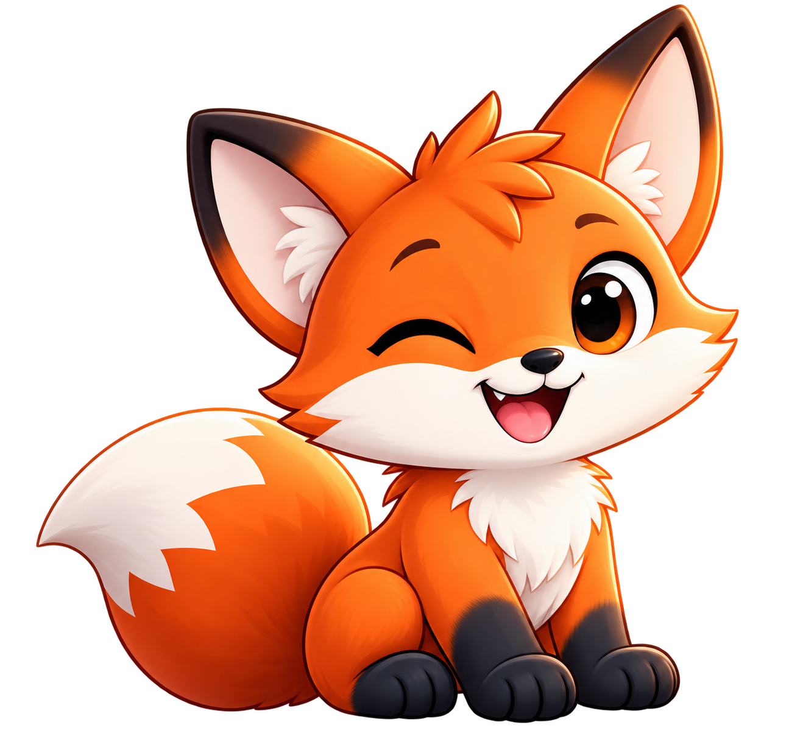
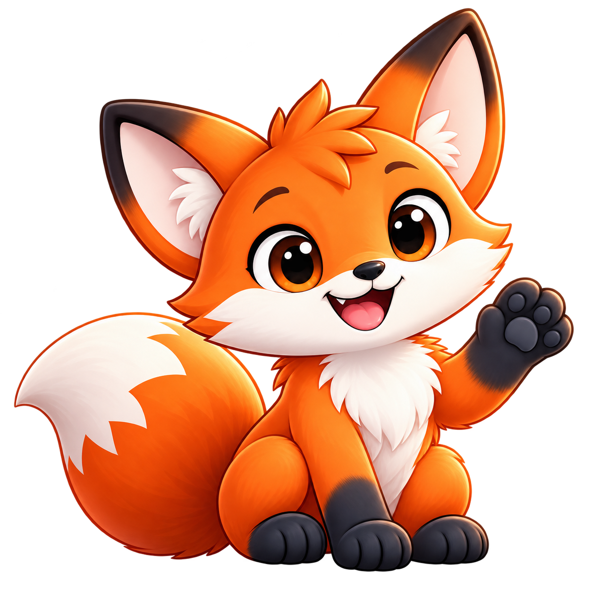
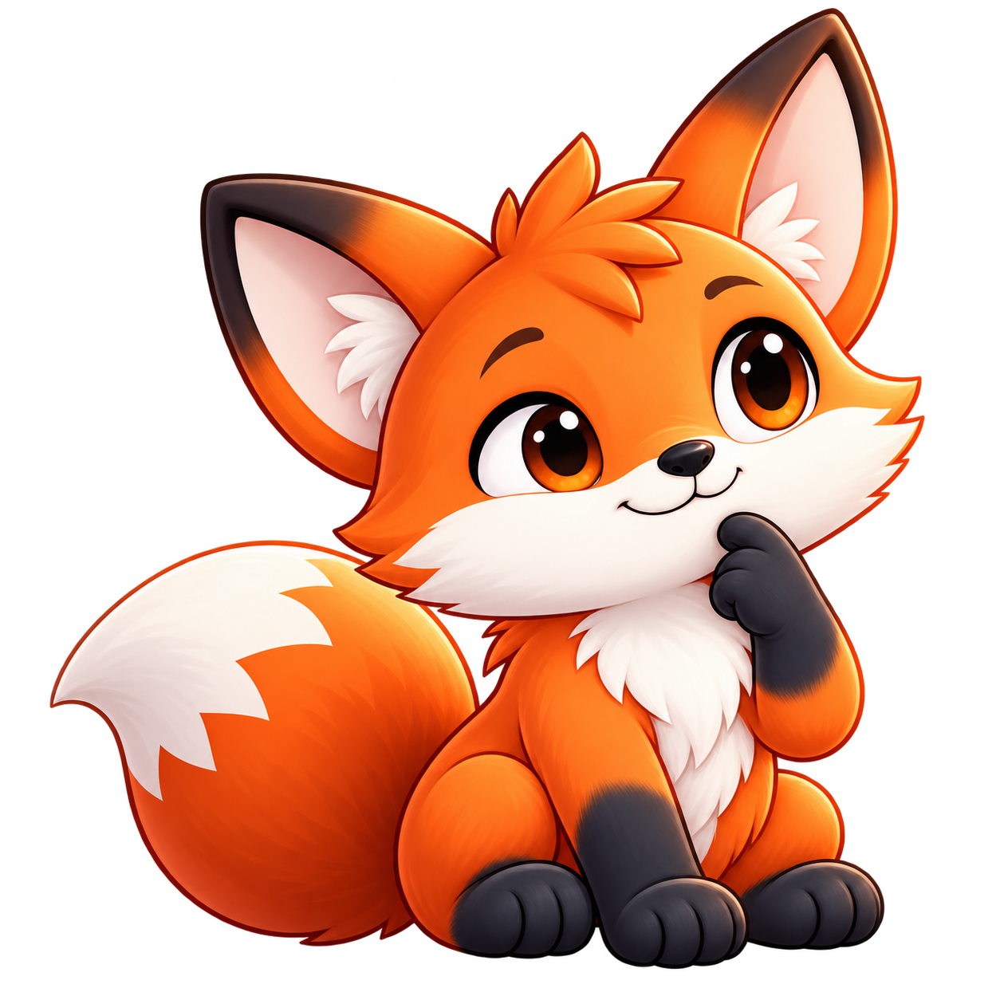
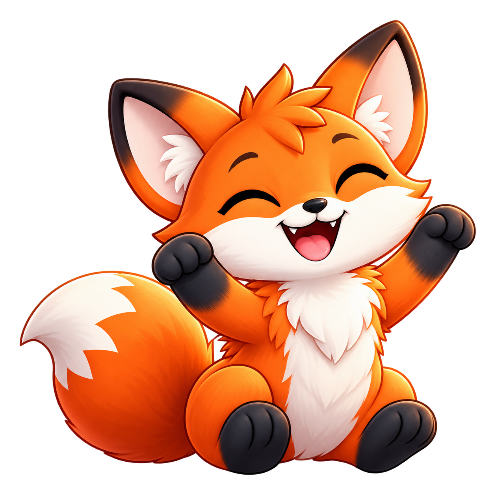

<div align="center">



# Hola, soy Toto. 🦊

### Un pequeño zorro con un gran corazón JavaScript.

**La mascota oficial de Spanish Total.js.**

**Zorro rojo europeo (*Vulpes vulpes*) · Marca registrada en la OEPM · M4411785**

[Presentación web](https://totaljs-es.github.io/toto/) · [Conoce su historia](docs/historia.md) · [Guía de identidad](docs/identidad.md) · [Poses y uso en apps](docs/poses.md) · [Condiciones de uso](LICENSE.md) · [English](README.en.md)

</div>

Toto es un **zorro rojo europeo** (*Vulpes vulpes*) y pone cara a una forma de hacer las cosas: sentir curiosidad, aprender juntos y disfrutar construyendo. Nos acompaña entre líneas de código, primeras versiones, preguntas difíciles y pequeños logros que merecen celebrarse.

Su casa es **Spanish Total.js**. Esta es su presentación, su guía de identidad y la colección de recursos que utilizamos en nuestras aplicaciones y comunicaciones.

## Una historia que empieza con una pregunta

En octubre de 2026 nos hicimos una pregunta: **¿y si nuestra comunidad tuviera un compañero propio?**

Queríamos un personaje cercano y reconocible. Alguien que pudiera dar la bienvenida en una app, acompañar una explicación o celebrar una nueva versión con nosotros. El primer boceto miraba hacia un fénec, con sus grandes orejas. La idea terminó tomando la forma de un zorro rojo europeo.

Ese zorro nos recordaba dos lugares importantes para nuestra historia: España, donde crece Spanish Total.js, y Eslovaquia, donde nació Total.js. Sus orejas conservaron aquella curiosidad inicial. Su cola se hizo grande, su sonrisa apareció y encontramos un nombre que cabía en cualquier conversación: **Toto**, un guiño a Total.js.

Hoy Toto es la mascota oficial de **Spanish Total.js**.

[Leer la historia completa →](docs/historia.md)

## Un zorro rojo europeo

Toto es un **zorro rojo europeo**, *Vulpes vulpes*: el mismo zorro que vive en los bosques, dehesas y campos de España y Eslovaquia. Lo reconoces por los rasgos de su especie.

| Ficha | Toto |
| --- | --- |
| Nombre común | Zorro rojo europeo |
| Nombre científico | *Vulpes vulpes* |
| Familia | Cánidos (*Canidae*) |
| Pelaje | Naranja rojizo, con pecho y hocico color crema |
| Orejas | Grandes, puntiagudas y con el borde oscuro |
| Patas | Oscuras, como unas medias de carbón |
| Cola | Grande y esponjosa, con la punta clara |
| Su tierra | España, donde crece Spanish Total.js, y Eslovaquia, donde nació Total.js |

## Así es Toto

| Rasgo | Cómo se nota |
| --- | --- |
| Curioso | Se asoma a lo que todavía estamos aprendiendo. |
| Cercano | Da la bienvenida y acompaña sin ocupar todo el espacio. |
| Ingenioso | Disfruta encontrando una solución sencilla. |
| Alegre | Celebra las pequeñas victorias del trabajo diario. |
| Un poco travieso | Un guiño, una taza de café y otra idea por probar. |

## Su primera colección

Las poses principales mantienen el acabado suave en 3D del Toto original. Cada imagen es un PNG independiente con transparencia; los identificadores permiten reutilizarla de forma consistente en nuestras apps.

| Pose | Vista | Cuándo usarla |
| --- | --- | --- |
| **Firma** · `signature` |  | Presentaciones, identidad y despedidas. |
| **Bienvenida** · `welcome` |  | Primer acceso, introducciones y bienvenida. |
| **Pensando** · `thinking` |  | Consejos, ayuda y preguntas. |
| **Programando** · `coding` |  | Tutoriales y tareas en curso. |
| **Celebrando** · `celebrate` |  | Una tarea completada o una nueva versión. |

La hoja ilustrada original se conserva como [referencia de expresiones](assets/reference/toto-character-sheet.png). Su estilo 2D es una referencia de desarrollo; la colección principal usa el acabado del Toto original.

## Una presentación para conocerlo

Visita **[totaljs-es.github.io/toto/](https://totaljs-es.github.io/toto/)**: su presentación visual, la historia, la ficha del zorro rojo europeo, una galería con fondos claro y oscuro y los criterios de uso. También disponible [en inglés](https://totaljs-es.github.io/toto/en/).

Para nuestras aplicaciones, consulta [el catálogo de poses](assets/poses/manifest.json) y los [ejemplos de integración](docs/poses.md).

```html

```

## Marca registrada

**Toto** es una marca registrada de Spanish Total.js en la OEPM, con el número **M4411785**.

[Datos de la marca →](docs/marca.md)

## Es nuestra mascota

**Licencia privativa. Todos los derechos reservados en la medida en que resulten aplicables.**

La colección está destinada al uso de Spanish Total.js y sus aplicaciones. Se permite a terceros mostrar los recursos oficiales únicamente para mencionar de forma veraz a Total.js, a Spanish Total.js o a sus apps, con atribución y enlace. La licencia detalla este permiso limitado y sus condiciones.

No se permite adoptar a Toto como mascota propia, crear derivados, vender productos con él ni redistribuir la colección como un paquete de recursos sin autorización escrita. El acceso al repositorio no equivale a una licencia abierta. En un repositorio público, GitHub permite visualizar y hacer forks según sus propias condiciones; eso no concede permiso para explotar la identidad de Toto.

[Consultar la licencia completa →](LICENSE.md)

## Créditos

**Concepto, nombre, historia y dirección de identidad:** Spanish Total.js, 2026.<br>
**Diseño:** Spanish Total.js.<br>
**Referencias conservadas:** el retrato original de Toto y su primera hoja de expresiones.

---

<div align="center">Hecho con curiosidad, código y un pequeño zorro naranja. 🦊<br>© 2026 Spanish Total.js · Uso sujeto a <a href="LICENSE.md">licencia privativa</a>.</div>
